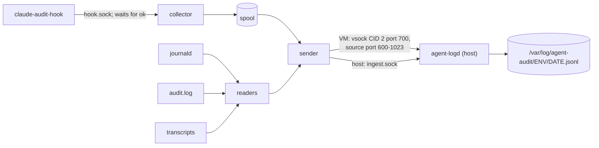

# Implementation details: restricted egress and audit logging

Status: Implemented (initial version)

Mechanics and formats of [`agent-egress/`](../../agent-egress/),
[`agent-audit/`](../../agent-audit/), and [`agent-logs/`](../../agent-logs/).
Rationale is in [overview.md](overview.md), concepts in
[background.md](background.md), installation and operation in the component
READMEs. Where a repository file is the clearest specification, it is
referenced by path.

## Repository layout and install paths

| Source | Installed as | Installer |
|---|---|---|
| `envs.conf.example` | `/etc/agent-tools/envs.conf` (only if missing) | both `install-host.sh` |
| `agent-egress/agent-egress-proxy` | `/usr/local/lib/agent-egress/` | `agent-egress/install-host.sh` |
| `agent-egress/allowlist.d/*.list` | `/etc/agent-egress/profiles/`, enabled by relative symlink in `/etc/agent-egress/allowlist.d/` | same |
| `agent-egress/nftables/*.nft` | `/etc/agent-egress/` (rendered) | same |
| `agent-egress/systemd/*`, `sysusers.d/agent-egress.conf` | `/etc/systemd/system/`, `/etc/sysusers.d/` | same |
| `agent-egress/libvirt/*.xml` | `/etc/agent-egress/libvirt/` (`agent-net.xml`, `<env>-interface.xml` per VM) | same |
| `agent-egress/managed-settings.d/40-agent-egress.json.in` | `/etc/claude-code/managed-settings.d/40-agent-egress.json` | `install-host.sh` (host), `vm/install-vm.sh` (VM) |
| Claude Code binary | `/opt/claude-code/<version>/claude`; `/usr/local/bin/claude` symlink | `agent-audit/install-claude.sh` |
| `agent-audit/claude-audit-hook` | `/usr/local/lib/agent-audit/` (0755) | `agent-audit/install.sh` |
| `agent-audit/agent-run` | `/usr/local/sbin/` (0755) | same |
| `agent-audit/managed-settings.d/50-agent-audit.json` | `/etc/claude-code/managed-settings.d/` (0644) | same |
| `agent-audit/pam.d/agent-run`, `sysctl.d/60-agent-ptrace.conf` | `/etc/pam.d/`, `/etc/sysctl.d/` | same |
| `agent-audit/audit.rules` | `/etc/audit/rules.d/50-agent.rules` (0640, rendered) | same |
| `agent-logs/agent-log-shipper` + unit | `/usr/local/lib/agent-logs/`; mode in `/etc/agent-tools/agent-log-shipper.env` | `agent-logs/install-env.sh` (every environment) |
| `agent-logs/managed-settings.d/45-agent-otel.json.in` | `/etc/claude-code/managed-settings.d/45-agent-otel.json` | `install-env.sh --otel` |
| `agent-logs/agent-logd`, `agent-log`, units, `sysusers.d`, `tmpfiles.d` | `/usr/local/lib/agent-logs/`, `/usr/local/bin/agent-log` symlink, `/etc/modules-load.d/agent-logs.conf` (`vhost_vsock`) | `agent-logs/install-host.sh` |

All installers are idempotent and accept `--root DIR` (stage into a
directory without root; system commands are skipped); all but
`install-claude.sh` also accept `--dry-run`. The Python programs are single
standard-library files started as `python3 -I` (no `PYTHON*` variables, no
user site directory).

**Accounts.** `sysusers.d` creates `agent-egress`, `agent-logd`, and the
group `agent-audit` (store readers). The administrator defaults to
`$SUDO_USER` for `agent-audit/install.sh --admin-user` (kept in `cron.allow`
and `at.allow`; required if `$SUDO_USER` is unset or root) and
`agent-logs/install-host.sh --reader` (added to `agent-audit`).

**The agent account** is `agent` by default. Pass the same `--agent-user` to
`agent-egress/install-host.sh` (nft UID), `agent-audit/install.sh` (audit-rule
UID and home, `agent-run`'s `AGENT_USER`, allow files, linger), and
`agent-logs/install-env.sh` (the shipper's transcript root).

## Environment registry: envs.conf

`/etc/agent-tools/envs.conf` on the host names each VM environment
(template: [`envs.conf.example`](../../envs.conf.example)):

```
# name       vsock CID   IP on agent-net    MAC
agent-vm1    cid=10      ip=192.168.123.10  mac=52:54:00:a9:00:10
```

Names match `[a-z0-9][a-z0-9-]*`; `#` starts a comment; `host` is reserved
for the host and never listed. The egress installer requires IPs in
`192.168.123.2`–`254`.

| Reader | Uses | On a malformed file |
|---|---|---|
| `agent-egress-proxy` | IP → name for VM clients | exit 1 at startup; on reload, old config kept |
| `agent-logd` | CID → name (vsock); IP → name (OTLP) | rejects every VM until fixed; re-read whenever its mtime changes |
| `agent-log-shipper` (host) | `SRC=` → `client_env` for VM drop logs | error logged; drop records get no `client_env` |
| `agent-egress/install-host.sh` | static DHCP leases; per-VM interface XML | installer error |

## Egress proxy

`agent-egress/agent-egress-proxy`: asyncio, one task per client connection.

**Listeners** come from `agent-egress-proxy.socket` (`ListenStream=
127.0.0.1:3128` and `192.168.123.1:3128`, `FreeBind=yes`) via `LISTEN_FDS`.
The listener kind follows from its address: loopback serves `host` and
accepts only client `127.0.0.1`; any other address serves VMs and looks the
client IP up in `envs.conf`. `--listen ADDR:PORT[=host|vm]` exists for tests.

**Per request:**

1. Unknown client → close, `unknown-client`. More than 64 open connections
   from one client → `429`.
2. Read the request head (30 s, 64 KiB). Accept `CONNECT host:port` or
   absolute-URI `GET`/`HEAD http://host[:port]/…`. Malformed → `400`; another
   well-formed method → `405`.
3. Normalize the host: lowercase, strip one trailing dot, IDNA (Python's
   IDNA 2003 codec, applied identically to allowlist entries). Refuse IP
   literals in any spelling, including what `inet_aton` accepts (`127.1`,
   `2130706433`, `0x7f.1`): any name whose last label is decimal or `0x` hex.
4. Allowlist match, then port: 443 for `CONNECT`, 80 for HTTP.
5. Resolve with `getaddrinfo` (10 s). If *any* address is not
   `is_global` — judging IPv4-mapped, IPv4-compatible, 6to4, and NAT64
   addresses by their embedded IPv4 — deny `non-global-address`. Otherwise
   try the addresses in order (10 s each) and log the one used. The name is
   never resolved again.
6. `CONNECT`: reply `200`, then read the ClientHello (5 s, 16 KiB,
   reassembled across records) *before* connecting upstream. Require exactly
   one `host_name` SNI equal to the normalized `CONNECT` host, no ECH
   extension (`0xfe0d`), and no duplicate extensions. Then connect, forward
   the buffered bytes, and copy in both directions (10-minute idle timeout).
7. HTTP: refuse userinfo and any body (`Transfer-Encoding`, or
   `Content-Length` other than `0`); set `Host` from the URI; drop
   `Proxy-*`, hop-by-hop, and `Connection`-listed headers; force
   `Connection: close`; keep the client's HTTP version; forward one request.

**Decision log.** One JSON line per connection on stdout (journald, unit
`agent-egress-proxy.service`), written when the connection ends.
Operational messages go to stderr as plain text; consumers skip lines that
do not start with `{`.

```json
{"ts":"2026-10-27T21:30:32.969Z","env":"host","client":"127.0.0.1","method":"CONNECT","host":"api.github.com","port":443,"sni":"api.github.com","addr":"140.82.112.6","decision":"allow","reason":null,"bytes_up":1918,"bytes_down":4358,"duration_ms":301}
```

`ts` is when the connection was accepted; `env` is the client environment
(`null` if unknown); `addr` is the pinned upstream, or the offending address
for `non-global-address`. Client-supplied strings are cut to 256 characters.

| `reason` | `decision` | Client sees |
|---|---|---|
| `not-allowlisted`, `bad-port`, `ip-literal`, `userinfo`, `non-global-address` | deny | 403 |
| `bad-request`, `bad-host`, `request-body` | deny | 400 |
| `bad-method` | deny | 405 |
| `header-timeout` / `header-too-large` | deny | 408 / 431 |
| `too-many-connections` | deny | 429 |
| `resolve-failed` | deny | 502 |
| `upstream-connect-failed` | deny | 502 (HTTP); closed after `200` (CONNECT) |
| `unknown-client`, `client-closed` | deny | connection closed |
| `sni-mismatch`, `sni-missing`, `ech`, `not-tls`, `client-hello-timeout`, `client-hello-too-large` | deny | closed after `200` |
| `null`, `idle-timeout`, `io-error: <type>` | allow | how an allowed connection ended |
| `internal-error: <type>` | either | unexpected exception (a bug) |

**Reload.** `SIGHUP` (`systemctl reload`) re-reads the allowlist and
`envs.conf`; a missing allowlist directory denies everything.

**Unit** (`systemd/agent-egress-proxy.service`): `User=agent-egress`,
`Requires=` the socket and `agent-egress-nft.service`, no capabilities,
`ProtectSystem=strict` and related sandboxing, `MemoryMax=256M`,
`LogRateLimitIntervalSec=0`.

## Allowlist

`/etc/agent-egress/allowlist.d/*.list`: one pattern per line, `#` comments.
`example.com` matches exactly; `.example.com` matches the apex and every
subdomain. IP literals and `*.` wildcards are skipped with a warning.
Profiles from [`agent-egress/allowlist.d/`](../../agent-egress/allowlist.d/)
go to `/etc/agent-egress/profiles/` (overwritten on install): `anthropic` and
`github` always enabled, `npm`, `pypi`, and `ubuntu` (VM `apt`) with
`--enable NAME`. Local additions go in their own file in `allowlist.d/`.

`anthropic` follows Claude Code's "Network access requirements" minus the
nonessential telemetry hosts (disabled by managed settings) and
**`mcp-proxy.anthropic.com`** (claude.ai MCP connectors, a broad data
channel). Claude Code still tries the latter, about 16 denied `CONNECT`s per
session start, and works without it. `npm` and `pypi` sit on shared CDNs;
prefer a local mirror (verdaccio, devpi) where `Host`-header fronting
matters. To build a list, run the task and read `agent-log net --denied`.

## Host firewall: agent_egress

`agent-egress/nftables/agent-host.nft`, rendered with the agent's numeric
UID (a name would fail to parse where the user does not exist) and the
dev-port range (`--dev-ports`, default `8000-8999`). Its `output` chain
(priority `filter`, policy accept) jumps to `agent_out` only for
`meta skuid <uid>`; other users' packets are untouched:

```nft
chain agent_out {
    oifname "lo" ct state established,related accept
    ip daddr 127.0.0.1 tcp dport { 3128, 4318 } accept
    ip daddr 127.0.0.1 tcp dport @dev_ports accept
    ip6 daddr ::1 tcp dport @dev_ports accept
    limit rate 10/second log prefix "agent-egress-drop " flags skuid
    counter drop
}
```

- The file starts with `table inet agent_egress` / `delete table inet
  agent_egress`, so loading replaces only this table and never needs
  `flush ruleset` (which would also wipe libvirt's rules).
- Loopback replies are allowed so the administrator's browser can reach an
  agent's dev server; replies leaving through a real interface are dropped.
  Every host address is routed over `lo`, so the `daddr` checks restrict the
  agent to `127.0.0.1` and `::1`.
- `agent-egress-nft.service` (`Type=oneshot`, `RemainAfterExit`,
  `DefaultDependencies=no`, `Before=network-pre.target`) loads both tables
  early in boot after an install-time `nft -c`. It has **no `ExecStop`**:
  stopping it must not open egress; remove rules with `nft delete table`.

## Isolated VM network

`agent-egress/libvirt/agent-net.xml` defines `agent-net` on bridge
`virbr-agent` (`192.168.123.1/24`): no `<forward>`, `<dns enable='no'/>`,
`<port isolated='yes'/>` network-wide, and DHCP with only the static
`<host mac ip>` leases rendered from `envs.conf` (no dynamic range). The
installer defines, autostarts, and starts it; if the definition changed
while the network is running, it prints the restart commands instead. For
each `envs.conf` entry with a `cid=` it renders
[`vm-interface.xml`](../../agent-egress/libvirt/vm-interface.xml) to
`/etc/agent-egress/libvirt/<env>-interface.xml`: an `<interface>` on
`agent-net` with the entry's MAC, `<port isolated='yes'/>`, and the
`clean-traffic` filter with `IP` set to its address, plus
`<vsock><cid auto='no' address='CID'/></vsock>`. The administrator puts it
into the VM's domain XML (`virsh edit`) in place of every other
`<interface>`.

The host guard table `agent_vmnet` (`agent-egress/nftables/agent-vmnet.nft`,
priority `filter - 1`, same replace-only-this-table idiom):

- `input`, for packets arriving on `virbr-agent` only: accept established
  flows, DHCP (`udp dport 67`), and TCP 3128/4318 to `192.168.123.1`; log
  (`agent-vmnet-drop `, 10/s) and drop the rest.
- `forward`: drop everything entering or leaving `virbr-agent`, logging
  inbound attempts as `agent-vmnet-fwd-drop `.
- An active ufw or firewalld input policy applies as well; allow
  `virbr-agent` → `192.168.123.1` TCP 3128 and 4318 there.

**Inside each VM**, `agent-egress/vm/install-vm.sh` writes the proxy
variables in both cases to `/etc/environment` (`no_proxy=localhost,
127.0.0.1,::1,192.168.123.1`), `/etc/apt/apt.conf.d/90agent-proxy`, the
GitHub `insteadOf` rewrite to `/etc/gitconfig`, and `40-agent-egress.json`
with proxy `192.168.123.1` (`--proxy` to change). Every VM account shares
the allowlist; for unrestricted work, hot-plug a NIC on another network
(`virsh attach-interface … --live`) and remove it afterwards.

## Managed settings

Drop-ins in `/etc/claude-code/managed-settings.d/` (root, 0644), merged in
name order with any hand-written policy. They apply to every Claude Code
session on the machine, the administrator's included.

**`40-agent-egress.json`**
([template](../../agent-egress/managed-settings.d/40-agent-egress.json.in);
`@PROXY@` = `127.0.0.1` on the host, `192.168.123.1` in VMs) sets in `env`:
`HTTPS_PROXY`, `HTTP_PROXY`, and their lowercase forms to
`http://@PROXY@:3128`; `NO_PROXY`/`no_proxy` to
`localhost,127.0.0.1,::1,@PROXY@`; `CLAUDE_CODE_PROXY_RESOLVES_HOSTS=1`;
`CLAUDE_CODE_DISABLE_NONESSENTIAL_TRAFFIC=1`; and a `GIT_CONFIG_COUNT`/
`GIT_CONFIG_KEY_0`/`GIT_CONFIG_VALUE_0` triple that rewrites
`git@github.com:` remotes to HTTPS for Claude Code sessions only, leaving
the host's `/etc/gitconfig` untouched.

**`50-agent-audit.json`**
([file](../../agent-audit/managed-settings.d/50-agent-audit.json)) sets the
keys below and, for each of the ten events `PreToolUse`, `PostToolUse`,
`PostToolUseFailure` (these three with `"matcher": "*"`), `SessionStart`,
`UserPromptSubmit`, `SubagentStart`, `SubagentStop`, `Stop`,
`ConfigChange`, and `SessionEnd`, one hook `{"type": "command", "command":
"/usr/local/lib/agent-audit/claude-audit-hook", "timeout": 10}`.

| Key | Why |
|---|---|
| `allowManagedHooksOnly: true` | Ignore hooks from user, project, local, and plugin settings |
| `disableAllHooks: false` | A project-level `true` turned off higher-precedence hooks in testing |
| `env.DISABLE_AUTOUPDATER = "1"` | The root-owned install is never replaced behind the administrator's back |
| `env.LD_PRELOAD`, `LD_LIBRARY_PATH`, `LD_AUDIT`, `BASH_ENV`, `ENV`, `GCONV_PATH` = `""` | Loader and shell start-up injection into hooks and tools; a preloaded library could make the hook exit 0 without sending anything |
| `env.CLAUDE_CODE_SHELL_PREFIX = ""` | Claude Code wraps *hook* commands with it too; a prefix that exits 0 made every hook "succeed" without running |
| `timeout: 10` | Bounds a hung hook; the hook's own deadline is 5 s |
| `"onFailure": "block"` on `PreToolUse` only | No tool call runs without a stored record; other events fail open |

`permissions.disableBypassPermissionsMode` must not be set: it rejects
`--dangerously-skip-permissions`.

**[Verified](../../agent-audit/README.md#verification-results-claude-code-21312)
with Claude Code 2.1.312**, `--settings` standing in for managed settings
(root-owned files not yet verified): hooks fire under
`--dangerously-skip-permissions` and `onFailure: "block"` stops the tool
call; a higher-precedence `""` reaches children set-and-empty, but
lower-precedence-only variables pass through, so every pin must be listed;
hooks run as `python3 -I <hook>` ← `dash` (`/bin/sh -c`) ← `claude`, while
Bash-tool commands run under `/bin/bash -c 'source …/shell-snapshots/… &&
eval …'` ← `claude`.

## Root-owned Claude Code

`agent-audit/install-claude.sh --binary PATH [--sha256 HASH]` verifies the
hash when given, copies the binary into `/opt/claude-code/` *before* running
it, and runs `--version` as `nobody`, so an untrusted binary never runs as
root. It installs `/opt/claude-code/<version>/claude` (root, 0755; the same
version with different contents is refused) and repoints
`/usr/local/bin/claude` atomically (temporary symlink + rename). New
`agent-run` sessions pick up the new version; running ones keep theirs.

## Hook protocol

`claude-audit-hook [--socket PATH]` (default `/run/agent-log-shipper/hook.sock`;
`--socket` is for tests and never read from the environment):

1. Point fd 1 at `/dev/null`; read the event JSON from stdin (≤ 64 MiB).
2. Cut every string at any depth to 16 KiB of UTF-8 (on a character
   boundary), recording `audit.truncated["<JSON pointer>"] = {"length",
   "sha256"}` of the original. Over-long dict keys are cut too, with `#` and
   16 hex digits of their hash appended, and `"key": true` in the entry.
3. If header + body would exceed 1 MiB, replace both `tool_input` and
   `tool_response` with `{"length", "sha256"}` stubs (hash of the compact
   JSON); if still too large, stub other top-level fields, largest first.
4. Set `"audit": {"truncated": …, "hook_ts": "<RFC 3339 UTC, ms>"}`
   (`truncated` only if something was cut), replacing any incoming `audit`.
5. Send one frame: 4-byte big-endian length + UTF-8 JSON (≤ 1 MiB). Lone
   surrogates fall back to ASCII-escaped JSON.
6. Wait for exactly `ok`. One 5 s deadline covers connect, send, and reply.

Exit 0 on `ok`; otherwise one line on stderr and exit 1. The hook never
exits 2 (argument parsing is hand-written because argparse exits 2) and never
writes stdout, so it can block an unrecorded tool call via `onFailure` but
cannot otherwise steer the agent. Its stderr line reaches the model.

## Hook collector

Part of `agent-log-shipper`. `/run/agent-log-shipper/hook.sock` is a stream
socket, mode 0666, at most 64 concurrent hook connections. While the hook
waits, the collector reads `SO_PEERCRED` and `/proc/<pid>/` and builds
`observed`:

| Field | Source |
|---|---|
| `pid`, `uid`, `gid` | `SO_PEERCRED` |
| `exe`, `cmdline` | `/proc/<pid>/exe`, `cmdline` |
| `auid`, `ses` | `/proc/<pid>/loginuid`, `sessionid` |
| `cgroup` | `/proc/<pid>/cgroup` |
| `ancestry` | `[{pid, exe, start_time}]` following `PPid` to PID 1 (≤ 128 steps) |
| `claude_pid`, `claude_exe` | nearest ancestor (excluding the hook) whose exe basename is not in `SHELLS` = `sh`, `dash`, `bash`, `zsh` |
| `run_id` | `AGENT_RUN_ID` from `claude_pid`'s environment |
| `loader_env` | **non-empty** `LD_*`, `BASH_ENV`, `ENV`, `GCONV_PATH` in the hook's environment (the pins make them empty) |
| `errors` | fields that could not be read |

Reading another user's `exe` and `environ` needs `CAP_SYS_PTRACE`. PID
reuse between `SO_PEERCRED` and the `/proc` reads is accepted: the hook
stays blocked throughout, and Python exposes no pidfd peer credentials.

The collector queues `{ts, boot_id, observed, event}` (`ts` = receive time;
the hook's time is `event.audit.hook_ts`) to a single writer thread, which
appends, calls `fsync` once per burst, and only then lets the handler reply
`ok`. A bad frame, full spool, or write or `fsync` error closes without `ok`.

**Spool.** `/var/lib/agent-log-shipper/spool/hook-<seq>.jsonl`, 64 MiB
segments, 1 GiB cap. `seq` is kept in `state.json` and never resets, so
`source_id` `<seq>:<offset>` is unique for the life of the environment.
Segments are deleted once fully acked by `agent-logd`. In local mode the
oldest segment is deleted above 90% of the cap and a `meta spool-pruned`
record is written. On start, a torn last line (crash mid-write) is dropped.

## agent-run

`sudo agent-run [--env host|vm] [--dir PROJECT] [-- CLAUDE_ARGS...]`.
`--env` defaults to `vm` if `systemd-detect-virt --vm` succeeds; `--dir`
defaults to the current directory. `PATH` is fixed. The command it executes
(`--print` shows it without running; `--root DIR` is accepted only with
`--print`, so it can never weaken a real launch):

```bash
systemd-run --uid=agent --gid=agent --pty --wait --collect \
  --unit="agent-run-$RUN_ID" \
  -p PAMName=agent-run \
  -p WorkingDirectory="$PROJECT" \
  -p NoNewPrivileges=yes \
  -p RestrictAddressFamilies="AF_UNIX AF_INET AF_INET6 AF_NETLINK" \
  -p SystemCallArchitectures=native \
  -p SystemCallFilter="~io_uring_setup io_uring_enter io_uring_register" \
  -p SystemCallErrorNumber=EPERM \
  -p IPAddressDeny=any -p IPAddressAllow="localhost" \
  -p InaccessiblePaths="-/run/systemd/resolve -/run/dbus -/run/avahi-daemon -/run/cups" \
  --setenv=AGENT_RUN_ID="$RUN_ID" --setenv=TERM="${TERM:-dumb}" \
  -- /usr/local/bin/claude --dangerously-skip-permissions "${CLAUDE_ARGS[@]}"
```

- `RestrictAddressFamilies` filters `socket(2)` for the native ABI only, so
  the 32-bit ABI and io_uring (which can create sockets) are blocked;
  `EPERM` lets runtimes that probe for io_uring fall back to epoll.
- `RUN_ID` = `YYYYmmddTHHMMSS-<8 hex>` (UTC). It is a convenience label:
  children can change it; `ses` and the cgroup are authoritative.
- In VMs, `IPAddressAllow` also lists `192.168.123.1` and
  `InaccessiblePaths` is omitted.
- The `IPAddress*` properties (and, on the host, the `nft list table inet
  agent_egress` check) apply only when `40-agent-egress.json` exists;
  otherwise agent-run warns `egress control not installed` and launches
  (phase 1).
- Directories, not socket files, are hidden: a hidden file reappears in
  running sessions when its daemon recreates it. snapd's sockets sit directly
  in `/run`; `agent-egress/install-host.sh --mask-snapd` masks snapd instead.
- `/etc/pam.d/agent-run` is exactly:

  ```
  account required pam_permit.so
  session required pam_loginuid.so
  ```

  No `pam_systemd`, which would move `claude` into a logind scope outside
  the unit and start a `systemd --user` manager. systemd sets `HOME`,
  `USER`, and `SHELL` from `--uid`; `XDG_RUNTIME_DIR` stays unset.

**Pre-launch checks.** agent-run reports every failure and exits 1 unless:
`50-agent-audit.json` exists; the hook is executable; the collector socket
exists; `/usr/local/bin/claude` is a symlink straight to a root-owned
executable regular file `/opt/claude-code/<version>/claude`;
`ptrace_scope` is readable and ≥ 1; `/run/agent-log-shipper/audit-degraded`
is absent; and, on the host with egress installed, the `agent_egress` table
is loaded.

**Escape hatches.** `agent-audit/install.sh` removes the agent from
`/etc/cron.allow` and `/etc/at.allow` (adding `root` and the admin), runs
`loginctl disable-linger` for it, and sets `kernel.yama.ptrace_scope = 1`
(applied now only if the live value is lower). Processes that still escape
a run are recorded by auditd by UID.

## Kernel audit rules

`agent-audit/audit.rules`, rendered with the agent's numeric UID and home
directory to
`/etc/audit/rules.d/50-agent.rules` and loaded with `augenrules --load`:

```
-b 8192
-a always,exit -F arch=b64 -S execve,execveat -F uid=@AGENT_UID@ -k agent-exec
-a always,exit -F arch=b32 -S execve,execveat -F uid=@AGENT_UID@ -k agent-exec
-a always,exit -F arch=b64 -S socket -F a0=17 -F uid=@AGENT_UID@ -k agent-socket
-a always,exit -F arch=b64 -S socket -F a0=40 -F uid=@AGENT_UID@ -k agent-socket
-a always,exit -F arch=b32 -S socket -F a0=17 -F uid=@AGENT_UID@ -k agent-socket
-a always,exit -F arch=b32 -S socket -F a0=40 -F uid=@AGENT_UID@ -k agent-socket
-w @AGENT_HOME@/.claude/.credentials.json -p r -k agent-secret-read
-w @AGENT_HOME@/.ssh -p r -k agent-secret-read
-w /etc/claude-code/ -p wa -k agent-policy
-w /opt/claude-code/ -p wa -k agent-policy
-w /usr/local/bin/claude -p wa -k agent-policy
-w /usr/local/lib/agent-audit/ -p wa -k agent-policy
-w /usr/local/lib/agent-logs/ -p wa -k agent-policy
-w /usr/local/sbin/agent-run -p wa -k agent-policy
-w /etc/agent-tools/ -p wa -k agent-policy
-w /etc/sysctl.d/ -p wa -k agent-policy
-w /etc/pam.d/agent-run -p wa -k agent-policy
-w /etc/agent-egress/ -p wa -k agent-policy
-w /etc/audit/ -p wa -k agent-policy
-w /etc/systemd/system/ -p wa -k agent-policy
-w /etc/libvirt/qemu/networks/ -p wa -k agent-policy
```

- `uid=`, not `auid=`: `auid` stays the administrator's under
  `sudo -u agent`. `a0=17`/`40` are `AF_PACKET`/`AF_VSOCK`. A socket call
  refused by an `agent-run` unit's `RestrictAddressFamilies` (seccomp) never
  reaches the audited syscall exit, so `agent-socket` fires only outside
  `agent-run`. The 32-bit rules cover the direct `socket` syscall only, not
  the legacy `socketcall` multiplexer; `agent-run` units block the 32-bit ABI
  entirely. `NETFILTER_CFG` and `CONFIG_CHANGE` records need no rule.
- A `-w` whose parent directory is missing (e.g. libvirt in a VM) is
  installed commented out, because one rejected watch stops `auditctl`
  loading the rest. Re-run the installer if the directory appears.
- `auditd.conf` is edited in place (original kept as
  `auditd.conf.agent-audit.bak`): `admin_space_left_action`,
  `disk_full_action`, `disk_error_action` = `SUSPEND`; `max_log_file_action
  = ROTATE`. A full disk must not halt the machine; suspension is detected.

**audit-degraded.** At start and every 60 s the shipper compares free space
on the filesystem holding `/var/log/audit` with `admin_space_left` (MB or
`N%`; default 50). While below it, or while either value is unreadable, the
file `/run/agent-log-shipper/audit-degraded` exists (JSON reason) and
agent-run refuses to start; each transition writes `meta audit-degraded` or
`meta audit-recovered`. A dedicated filesystem for `/var/log/audit` is the
robust fix.

## Log shipper

`agent-log-shipper --mode host|vm|local` (from
`/etc/agent-tools/agent-log-shipper.env`). `local` (phase 1) runs only the
collector and the audit-space check; `host` and `vm` add the readers and the
sender. Each reader is a thread with its own cursor, so one stuck source
cannot stall the others:



| Source | Reads | `source_id` |
|---|---|---|
| hook | spool segments by byte offset | `<seq>:<offset>` |
| journal | `journalctl --all -o json --follow --after-cursor=…`; first start from the current boot | journal cursor |
| audit | `/var/log/audit/audit.log` by inode + offset, finishing a rotated file first; first start from the beginning of the live file | `<boot_id>:<time>:<serial>` |
| transcript | every 2 s: `~agent/.claude/projects/**/*.jsonl` plus every `transcript_path` / `agent_transcript_path` seen in hook records | `<path>:<inode>:<offset>` |

**journal** match groups (OR-ed with `+`; trusted fields re-checked after
reading): `_SYSTEMD_UNIT=agent-egress-proxy.service` with `_UID` of
`agent-egress` (JSON → `source=egress`, `client_env` from its `env`; text →
`meta proxy-log`); `_TRANSPORT=kernel` with a `MESSAGE` starting
`agent-egress-drop ` (`client_env=host`), `agent-vmnet-drop ` or
`agent-vmnet-fwd-drop ` (`client_env` from `SRC=` via `envs.conf`) →
`source=netfilter`; `MESSAGE_ID=a596d6fe7bfa4994828e72309e95d61e` →
`meta journal-suppressed`; `agent-log-shipper.service` (`_UID=0`) and
`agent-logd.service` (its UID) → `meta pipeline-log`.

**audit** lines are grouped by `msg=audit(<time>:<serial>)`; a group ends
at `EOE`, after 2 s without a line for it, or at the end of a rotated file.
Kept: keys `agent-exec`, `agent-socket`, `agent-secret-read`,
`agent-policy` (events `exec`, `socket`, `secret-read`, `policy`) and all
`NETFILTER_CFG`/`CONFIG_CHANGE` (`netfilter-cfg`, `config-change`). Hex and
split arguments are decoded; each argument is capped at 16 KiB and all at
512 KiB, with original length and SHA-256. Lines from before the current
boot (`btime`) keep the previous boot ID from the cursor.

**transcript** files are agent-controlled and read as root, so: walk with
`followlinks=False`; open `O_RDONLY|O_NOFOLLOW|O_NONBLOCK`; require a
regular file owned by the agent UID; ship complete lines only; lines over
1 MiB become `transcript-oversize` stubs; a shrink or inode change emits
`meta transcript-rewritten`. Records carry `data.claim = true`.

**Delivery.** The sender takes records round-robin from the sources and
sends NDJSON batches (≤ 500 records, ≈ 4 MiB) ending in `{"batch": n}`;
`agent-logd` answers `{"ack": n}` after `fsync`. Cursors go to
`/var/lib/agent-log-shipper/state.json` (0600) only after the ack, so
delivery is at-least-once. Failures back off exponentially up to 60 s; each
source buffers up to 1000 records, then blocks (hook records stay in the
spool). Transport: in VMs, `AF_VSOCK` to CID 2 port 700 after binding a
random source port in 600–1023; on the host, `/run/agent-logd/ingest.sock`.

**Unit** (`agent-logs/systemd/agent-log-shipper.service`): `User=root`,
`CapabilityBoundingSet=CAP_SYS_PTRACE CAP_DAC_READ_SEARCH
CAP_NET_BIND_SERVICE` (other users' `/proc`, transcripts in the agent's
home, privileged vsock port), `RestrictAddressFamilies=AF_UNIX AF_VSOCK`,
`ProtectSystem=strict`, `ProtectHome=read-only`, `RuntimeDirectory=` with
`RuntimeDirectoryPreserve=yes` (stable `hook.sock` and `audit-degraded`
across restarts), `StateDirectory=` (0700), `Restart=always`. It must not set
`ProtectProc=` or `PrivateUsers=`, which would hide the agent's processes.

## agent-logd

**Sockets** (systemd socket units; told apart by `FileDescriptorName=`):

| Unit | Listens | Peer accepted when | `env` |
|---|---|---|---|
| `agent-logd-vsock.socket` | `vsock::700` | CID listed in `envs.conf` and source port ≤ 1023; CID 1, CID 2, unknown CIDs rejected | name from `envs.conf` |
| `agent-logd-unix.socket` | `/run/agent-logd/ingest.sock` (0600 root) | `SO_PEERCRED` uid 0 | `host` |
| `agent-logd-otlp.socket` (optional) | `127.0.0.1:4318`, `192.168.123.1:4318` (`FreeBind`) | source IP is loopback or in `envs.conf` (else `403`) | `host`; `client_env` from the IP |

`vhost_vsock` is loaded at boot so `vsock::700` can bind. The stored `env`
and `recv_ts` are always the daemon's own; unknown top-level keys are dropped.

**Storage.** `/var/log/agent-audit/<env>/<YYYY-MM-DD>.jsonl` (UTC date of
`recv_ts`); directories 2750 `agent-logd:agent-audit`, files 0640. A line over 2 MiB becomes `meta oversize` (source, source_id,
length, SHA-256); an unparseable one or an unknown `source` becomes
`meta invalid-record`; both are acked. Each environment has a 2 GiB/day
quota (`--quota`): past it, one `meta quota-exceeded` is written and the
rest are dropped but still acked. OTel records go to
`host/otel-<date>.jsonl` with their own quota, so unauthenticated posts
cannot exhaust the hook-record quota. Recommended: `/var/log/agent-audit` on
its own filesystem; optionally `chattr +i` on finished days.

**Unit:** `User=agent-logd`, empty `CapabilityBoundingSet=`,
`RestrictAddressFamilies=AF_UNIX AF_VSOCK AF_INET AF_INET6`,
`ProtectSystem=strict`, `ReadWritePaths=/var/log/agent-audit`,
`UMask=0027`, `LogRateLimitIntervalSec=0`.

## OpenTelemetry

Optional: `install-host.sh --otlp` enables the receiver and
`install-env.sh --otel` installs `45-agent-otel.json`
([template](../../agent-logs/managed-settings.d/45-agent-otel.json.in):
OTLP logs and metrics as `http/json` to `http://@OTLP@:4318`, `@OTLP@` =
`127.0.0.1` on the host and `192.168.123.1` in VMs).

`agent-logd` accepts `POST /v1/logs` and `/v1/metrics` (JSON, optionally
gzip, ≤ 16 MiB) and flattens each log record or data point into an envelope
with `source=otel` and the `claude_code.` prefix removed from the event name
(e.g. `api_request`, `tool_result`, `token.usage`); `source_id` is a content
hash. The receiver is unauthenticated, so OTel records are supplementary
claims. Whether export works with `CLAUDE_CODE_DISABLE_NONESSENTIAL_TRAFFIC`
set remains to be confirmed on a live install (`no_proxy` already keeps it
off the proxy).

## Envelope schema

Every stored line:

```json
{"ts": "2026-10-27T18:04:11.532Z", "recv_ts": "2026-10-27T18:04:11.610Z",
 "env": "agent-vm1", "client_env": null, "boot_id": "5c0e…",
 "source": "hook", "source_id": "3:18342", "run_id": "20261027T180401-9c1e22aa",
 "session_id": "4b1f…", "agent_id": null, "uid": 2000, "auid": 2000,
 "ses": 17, "pid": 41733, "event": "PreToolUse", "data": {"…": "…"}}
```

| `source` | `event` | `data` |
|---|---|---|
| `hook` | `hook_event_name` | `{observed, event}` |
| `audit` | `exec`, `socket`, `secret-read`, `policy`, `netfilter-cfg`, `config-change` | pid, ppid, auid, ses, uid, exe, argv, cwd, success, key, paths, records |
| `egress` | `connect` | the proxy's decision (`ts` = connection start) |
| `netfilter` | `drop` | prefix, parsed kernel log fields |
| `transcript` | `transcript`, `transcript-oversize` | path, claim, line |
| `otel` | e.g. `api_request`, `tool_result`, `token.usage` | attributes, body, resource |
| `meta` | `spool-pruned`, `audit-degraded`, `audit-recovered`, `transcript-rewritten`, `journal-suppressed`, `pipeline-log`, `proxy-log`, `quota-exceeded`, `oversize`, `invalid-record`, `audit-cursor-lost` | details |

`env` is the environment that *shipped* the record, from the transport.
Proxy decisions and VM drop logs are shipped by the host, so they and OTel
records also carry `client_env`, the environment the traffic came from.
`ts` is the source's time, `recv_ts` the host's. VMs should sync their clock
to the host (chrony with `refclock PHC /dev/ptp0`).

## Correlation

- **Dedup:** `(env, source, source_id)`.
- **Session** = hook records with the same `(env, session_id)`. Window: 2 s
  before the first hook record to 5 s after `SessionEnd`, or to 5 minutes
  after the last hook record if it has not ended.
- **exec → session:** same `(env, boot_id, ses)` inside the window. If
  several sessions share a `ses` and overlap, `ppid` is walked (exec records
  plus hook ancestry) to a session's `claude_pid`; unresolved execs appear in
  every candidate as `ambiguous`.
- **network → session:** records shipped by `host` whose `client_env` is the
  session's env, inside the window: `exact` with one candidate session,
  `probable` with several.

## agent-log CLI and verify

```
agent-log sessions [--env E]                    # START ENV SESSION SES TOOLS EXECS DENY STATE CWD
agent-log timeline SESSION [--exec] [--net] [--transcript] [--otel] [--all]
agent-log net [--denied] [--env E]              # --env filters on client_env
agent-log exec SESSION                          # process tree from auditd
agent-log tail [--env E] [--from-start]
agent-log verify [SESSION] [--env E]            # exit 1 on any FAIL
```

All take `--store DIR` (default `/var/log/agent-audit`), `--since` (`30m`,
`2h`, `1d`, `1w`, or an ISO date; ignored by `tail`), and `--json`.
`SESSION` is a session ID prefix or a run ID. Selected days are read into
memory; for large stores use `--since` or DuckDB
(`read_json_auto('/var/log/agent-audit/*/*.jsonl')`).

`verify` grades each finding FAIL (tamper or policy signal) or WARN
(incomplete or pipeline problem). Without a session it checks every session
plus store-wide window checks.

| Check | Level | Condition |
|---|---|---|
| `binary` | FAIL | a hook's `claude_exe` is outside `/opt/claude-code/` |
| `completeness` | WARN | a `PreToolUse` without `PostToolUse`/`PostToolUseFailure` by `tool_use_id`, or no `SessionEnd` (also normal after an interrupt) |
| `origin` | FAIL | hook `cmdline` is not the installed hook, or the ancestry between hook and `claude_pid` is not `dash` or `sh` (`HOOK_ANCESTRY_SHAPES`) |
| `forged-hook` / `hook-parent` | FAIL / WARN | auditd history of the hook's parent PID: genuine = one exec of `sh`/`dash` with `ppid` = `claude_pid`. A prior `bash` exec, a `shell-snapshots` argv (a Bash tool shell that `exec`'d `/bin/sh`), or any other shape = `forged-hook-suspect` (FAIL). No exec records = `unverifiable` (WARN, never a pass) |
| `injection` | FAIL / WARN | `loader_env` non-empty / unreadable |
| `policy` | FAIL / WARN | `agent-policy` audit events, or `NETFILTER_CFG` unregistering `agent_egress`/`agent_vmnet` objects, in the window (session env and host). FAIL when the change's `auid`/`uid` or audit session is the agent's (these survive a privilege escalation); otherwise WARN as administrator maintenance, e.g. a rules reload. Audit rule removals only warn |
| `unhooked-claude` | FAIL | an exec in the session's env whose exe or `argv[0]` is named `claude` but whose exe is outside `/opt/claude-code/` |
| `pipeline` | WARN | `meta` records reporting loss or rewrite (`quota-exceeded`, `journal-suppressed`, `transcript-rewritten`, `spool-pruned`, `audit-degraded`, `oversize`, `invalid-record`, `audit-cursor-lost`) or a `pipeline-log` with priority ≤ 3 |

## Testing

Tests run unprivileged (`python3 -m unittest discover -s <component>/tests`)
against local sockets and temporary directories; each component README lists
their coverage. CI
([`agent-tools-test.yml`](../../.github/workflows/agent-tools-test.yml))
runs them on Python 3.12 and 3.14, plus `shellcheck`, `jq` on the JSON
templates, and `agent-egress/tests/check-nft.sh` (`nft -c` on the rendered
rules). `agent-audit/tests/test_config.py` keeps the rules block above equal
to `agent-audit/audit.rules`.

Manually checked through the proxy (SNI sent, no ECH): curl, git, npm, pip,
uv (rustls), `gh` (Go), and Claude Code (Bun/BoringSSL); clients that send
GREASE ECH (Chromium-based browsers) are denied `ech`. Not exercised: loading
nft rules, real systemd units, auditd, journald, libvirt, and root-owned
managed settings.
